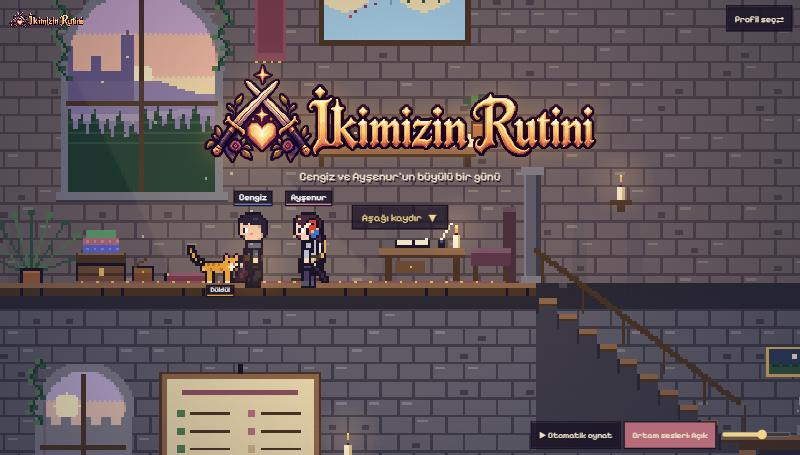
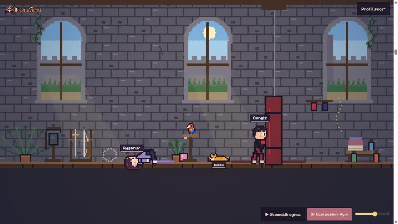
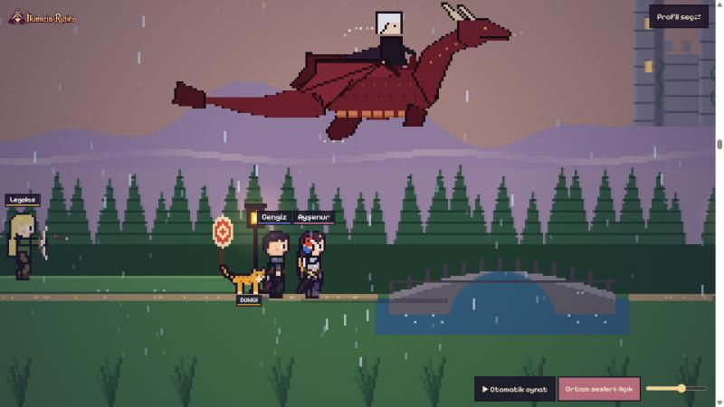
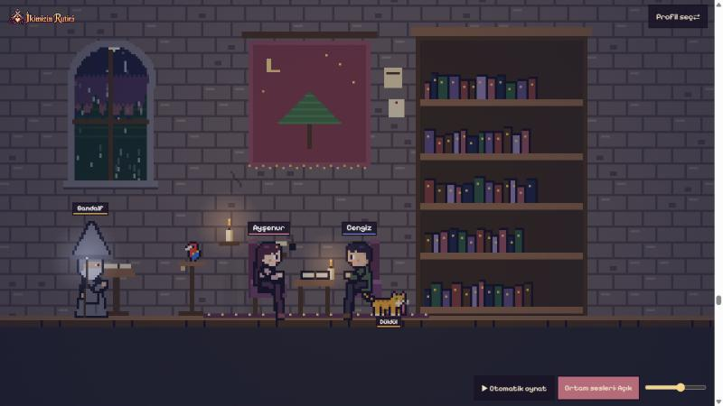
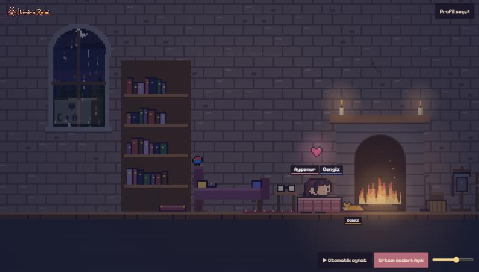
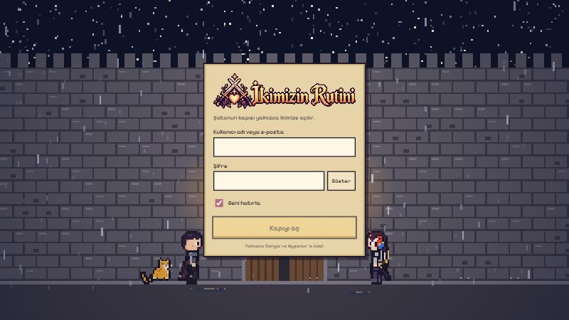

<p align="center">
  
</p>

<p align="center"><b>Cengiz ve Ayşenur'un büyülü bir günü.</b><br/>
Piksel art bir şatoda geçen kaydırmalı hikâye ve ikimizin günlük rutin paneli.</p>

<p align="center"><a href="https://ikimizin-rutini.vercel.app">ikimizin-rutini.vercel.app</a></p>

---

<p align="center"></p>

## Hikâye

Sayfayı aşağı kaydırdıkça gün ilerler: sabah antrenmanı, yağmurlu bahçeden şatoya yolculuk, yemek, banyo, kütüphanede kitap molası ve gece şömine başında "Seni seviyorum." Odalar arasında kararma yok; kamera kapıdan kapıya kayar. Gün saati, yağmur, şimşek ve ortam sesleri sahneye göre değişir.

<p align="center">
  
  
</p>
<p align="center">
  
  
</p>

Yol arkadaşları: sarı kedi **Düldül**, tünekteki papağan; misafirler **Gandalf**, **Gimli**, **Legolas**, kapıda nöbet tutan **Jon Snow** ve ejderhasıyla **Daenerys**.

## Rutin paneli

<p align="center"></p>

Şato kapısından girip profil seçilince "Macera Günlüğü" açılır:

- **Bugün:** sabah ve akşam bakım adımları, sayaçlar, öğünler ve antrenman
- **Cilt, Beslenme, Spor, Gelişim:** ürünler, yüz yogası, öğün planı, alışveriş listesi, spor kayıtları
- **Seviye ve XP:** her bakım tiki 10, öğün 15, yüz yogası 20, spor seansı 30 XP. Çırak'tan Efsane'ye kadar ünvanlar
- Arka planda şato salonu: şenlik ateşi başında Cengiz ile Ayşenur, Düldül ve papağan

## Geliştirme

```bash
npm install
npm run dev
```

Gerekli ortam değişkenleri `.env.local` içinde: `DATABASE_URL` (Neon Postgres), `CLOUDINARY_CLOUD_NAME`, `CLOUDINARY_API_KEY`, `CLOUDINARY_API_SECRET`, `AUTH_SECRET`.

```bash
npm run db:migrate   # veritabanı şeması
npm run typecheck
npm run build
```

Next.js 16 (App Router), React 19, canvas ile elle çizilen piksel art; Neon Postgres, Cloudinary, Vercel.

<p align="center">Yalnızca Cengiz ve Ayşenur'a özel. ❤️</p>
